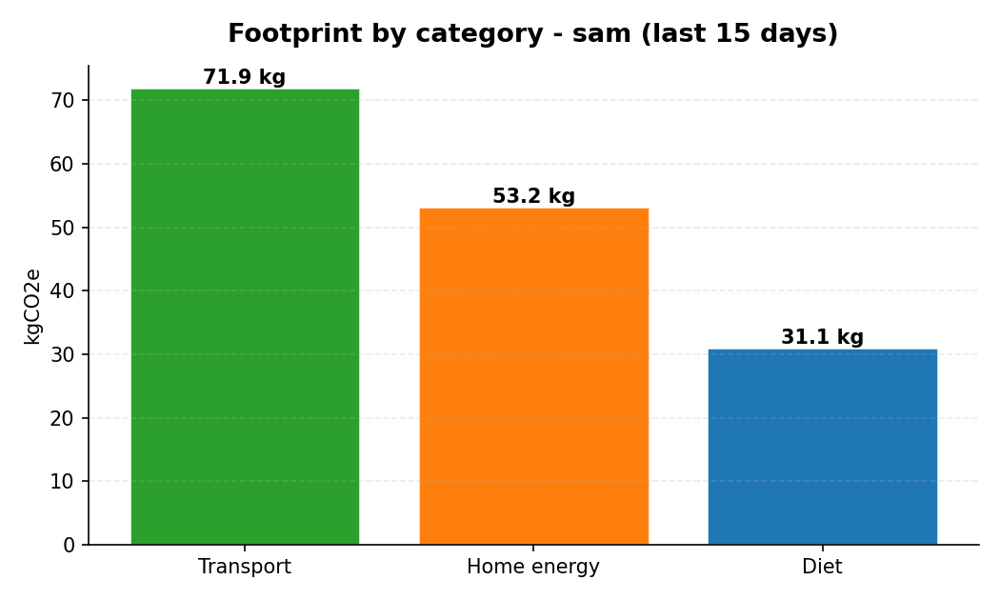
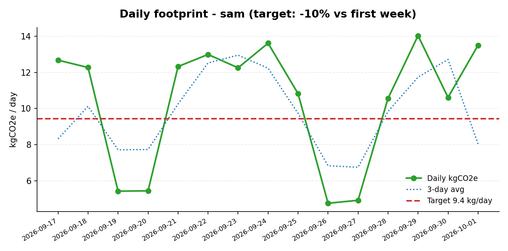

# CarbonCut 🌍


> **You can't cut what you don't measure — so let's make measuring social.**

## The Problem

Everyone *wants* a smaller carbon footprint, but nobody knows what theirs actually is. Carbon calculators are lonely spreadsheets: you type numbers into a web form, get a guilt-inducing score, and never come back. There's no feedback loop, no accountability, and no fun — so behavior never changes.

## The Solution

**CarbonCut** turns carbon tracking into a team sport:

1. **Log** daily activities in seconds — transport (mode + km), home energy (kWh by source), diet (meal counts) — stored in local SQLite, converted to kgCO₂e with a documented emission-factors file.
2. **See** your footprint on a matplotlib dashboard: breakdown by category, per-day trend against a −10% target line.
3. **Compete** in team challenges ("−10% this week"): join a team, keep logging, and climb a leaderboard ranked by *reduction vs. your own baseline* — so the frequent flyer and the cyclist compete fairly.
4. **Act** on rule-based tips driven by *your* top emission categories, each with an estimated weekly saving computed from your own data (car-heavy commuter → "swap 2 commutes for the bus, save ~X kg/week").

100% offline. No accounts, no API keys, no cloud. Your data never leaves your machine.

## Demo (60 seconds)

```bash
pip install -r requirements.txt

# 1. Seed bundled demo data: 3 teammates, 15 days, 1 live challenge
python -m carboncut log --demo

# 2. See the leaderboard (ranked by % reduction vs baseline)
python -m carboncut challenge leaderboard --id 1
# rank user        baseline  current     cut  target
# 1    leo            20.5     13.8   32.7%  HIT
# 2    priya          14.0     12.6   10.2%  HIT
# 3    sam            10.5     10.3    1.2%

# 3. Render your dashboard charts
python -m carboncut dashboard --user sam --days 15 --out ./dashboard

# 4. Get personalized reduction tips
python -m carboncut tips --user sam
# 1. Switch to a green electricity tariff  (~11.82 kg/wk)
# 2. Swap 2 car commutes a week for the bus  (~2.3 kg/wk)
# ...
```

Or log your own life:

```bash
python -m carboncut log transport --mode car_gasoline --km 25
python -m carboncut log energy --source grid --kwh 9.5
python -m carboncut log diet --meal beef --count 1
python -m carboncut challenge create --name "Cut 10%" --target-pct 10 \
    --start 2026-10-01 --end 2026-10-07
python -m carboncut challenge join --id 1 --user sam
```

## Features

| Area | What it does |
|---|---|
| 📝 Activity log | SQLite-backed log of transport (mode + km), home energy (kWh by source), diet (meal counts); per-user, per-day |
| 🧮 Emission factors | `emission_factors.json` with documented kgCO₂e factors (car 0.21/kg·km, bus 0.10, grid 0.42/kWh, beef 3.3/meal…) — **explicitly labeled as estimates**, with a disclaimer that real values vary by vehicle, grid mix and supply chain |
| 📊 Dashboard | matplotlib charts: footprint **by category** + **per-day trend** with 3-day average and a dashed **−10% target line** (90% of first-week mean) |
| 🏆 Team challenges | Create challenge, join team, leaderboard ranked by **% reduction vs. personal baseline** (mean daily kgCO₂e over the pre-challenge baseline window); HIT flags when the target is met |
| 💡 Tips engine | Rule-based suggestions driven by your top categories — transit swaps for car-heavy profiles, green tariffs/−10% cuts for grid-heavy homes, beef→chicken swaps for meat-heavy diets, rail for flyers — each with estimated kg/week savings from your own numbers |
| 🖥️ CLI | `log`, `dashboard`, `challenge`, `tips` subcommands; `log --demo` seeds a full working dataset out of the box |

## Tech

- **Python 3.10+**, stdlib `sqlite3` + `argparse` for the core — zero heavy frameworks
- **matplotlib** + **numpy** for charts (Agg backend: renders headless, CI-safe)
- **pytest** — 19 real tests: emission math on known inputs (100 km × 0.21 = 21 kg), leaderboard ordering by reduction %, tips engine firing the transit tip for a car-heavy profile
- Data: local SQLite (`~/.local/share/carboncut/carboncut.db`, overridable via `--db` / `$CARBONCUT_DB`)

## Screenshots

Real outputs generated by the code above, from the bundled demo data (teammate `sam`, last 15 days):

**Footprint by category**



**Daily trend vs. target**



## Project Structure

```
carboncut/
├── carboncut/
│   ├── __init__.py      # package metadata
│   ├── __main__.py      # `python -m carboncut` entry point
│   ├── cli.py           # CLI: log / dashboard / challenge / tips
│   ├── db.py            # SQLite schema + CRUD (activities, challenges, memberships)
│   ├── emissions.py     # kgCO2e math over emission_factors.json
│   ├── dashboard.py     # matplotlib charts (category + trend vs target)
│   ├── challenges.py    # challenge scoring + leaderboard by % reduction
│   ├── tips.py          # rule-based reduction suggestions engine
│   └── demo.py          # bundled demo dataset (3 users, 15 days, 1 challenge)
├── tests/               # 19 pytest tests (math, leaderboard, tips)
├── assets/              # hero banner + real dashboard screenshots
├── emission_factors.json# documented kgCO2e factors (estimates, with disclaimer)
├── requirements.txt     # matplotlib, numpy
├── LICENSE              # MIT
└── README.md
```

## Roadmap

- [ ] Per-trip GPS import (GPX) so logging is automatic, not manual
- [ ] Web dashboard (the CLI charts become an interactive page)
- [ ] Challenge streaks, badges, and head-to-head "carbon duels"
- [ ] Region-aware grid factors (Ontario's grid is far cleaner than the 0.42 default)
- [ ] Export: monthly PDF report for the fridge door 📄

---

*Built for a hackathon weekend. All emission factors are estimates for personal awareness — not carbon accounting.*
